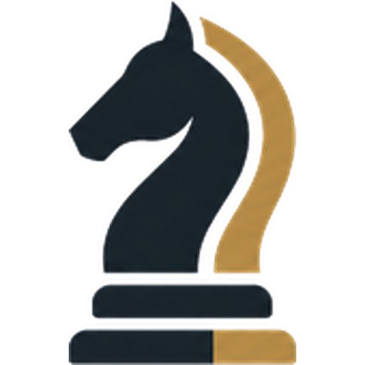

  

# chesstudia

**Tus partidas, tu plan de estudio.**

chesstudia conecta el análisis de tus partidas con lo que necesitás practicar.
Stockfish evalúa las posiciones; el plan reúne lecturas citadas de libros, ejercicios,
práctica contra Maia y repasos programados con FSRS. Un tutor con IA te acompaña con
el motor y la biblioteca como respaldo.

## Un recorrido para estudiar

1. **Analizá una partida.** Revisá tus jugadas, los errores y las variantes del motor.
2. **Elegí qué trabajar.** Seguí un plan a partir de tus debilidades y tu nivel.
3. **Estudiá con fuentes.** Consultá explicaciones con referencias de libro y página.
4. **Practicá.** Resolvé posiciones y jugá contra Maia sobre el tema que estás trabajando.
5. **Volvé a recordarlo.** Repasá posiciones con una programación basada en FSRS.

Mi estudio reúne las estaciones Tu nivel, Estudiar, Resolver, Jugar, Recordar y Consolidar.
También podés importar un PGN o enviar una foto de una posición para revisarla.

## Qué respalda una explicación

| Herramienta | Su papel |
|---|---|
| **Stockfish** | Evalúa las posiciones y respalda la clasificación de los errores. |
| **Biblioteca** | Aporta lecturas y explicaciones con libro y página. |
| **Tutor con IA** | Ayuda a recorrer el análisis y las fuentes. La evaluación corresponde al motor. |
| **Maia** | Es el rival para practicar. |
| **FSRS** | Programa los repasos. |

Una foto necesita validación antes de usarse como posición. El tutor puede equivocarse;
una explicación debe contrastarse con el motor y sus fuentes. La selección de ejercicios
según el nivel es heurística y no equivale a una medición de tu Elo.

## Documentación pública

Este repositorio presenta el producto y su recorrido de estudio. Descargarlo no instala
chesstudia ni incluye el código de la aplicación, libros, datos de alumnos o credenciales.

- [Cómo estudiar con chesstudia](docs/como-estudiar.md)
- Para consultar por acceso o una demostración, contactá a [Ariel Levy](https://github.com/arielelevy).

## Licencia

Software, documentación y recursos visuales propios: **licencia propietaria, todos los derechos
reservados**. Su publicación no autoriza el uso, la modificación ni la redistribución.
Consultá [LICENSE](LICENSE) para las condiciones y el contacto. Los componentes y materiales
de terceros conservan sus licencias.
